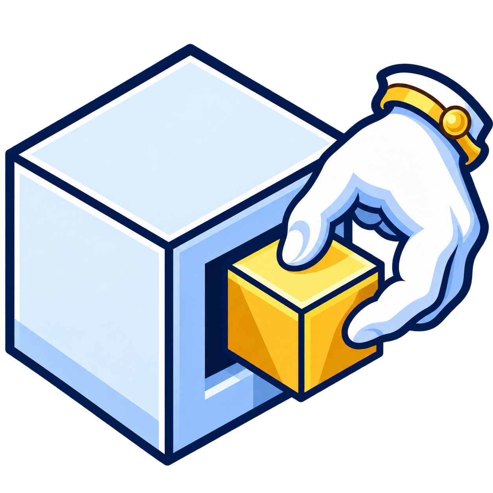
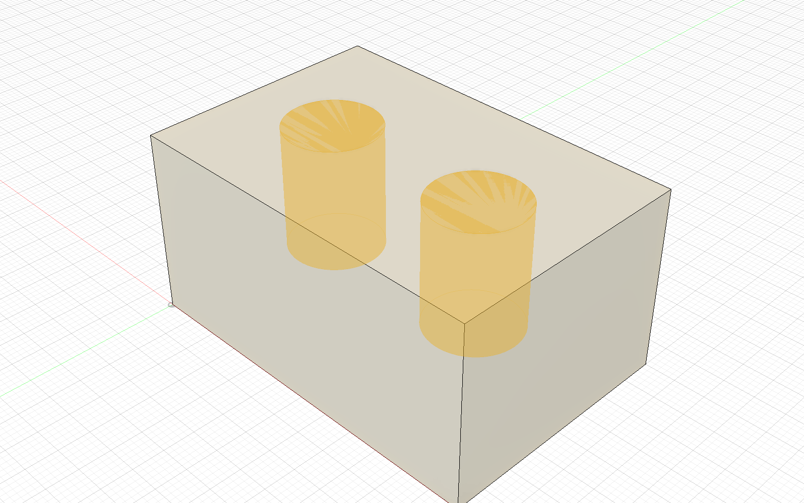
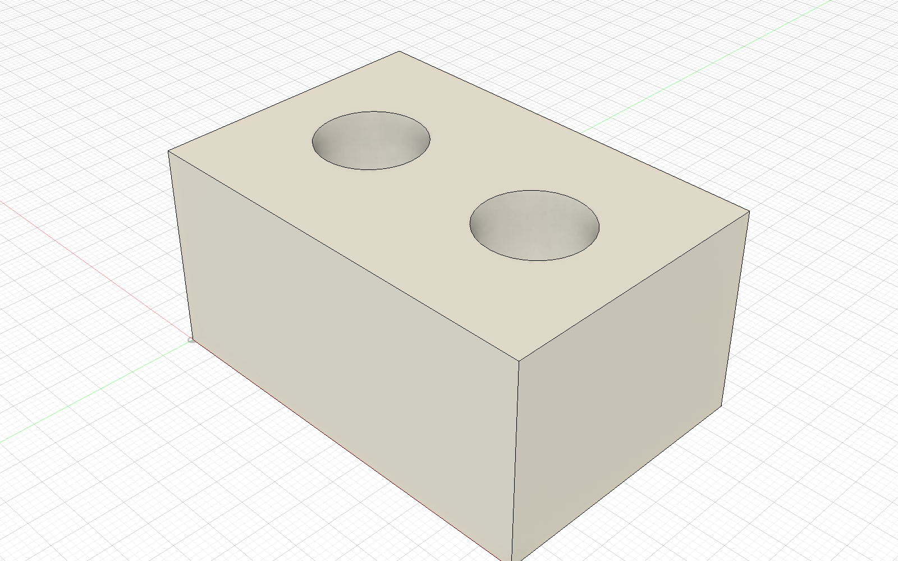
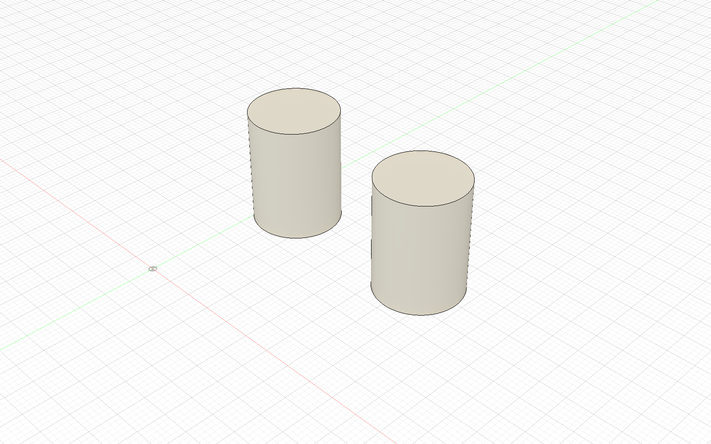

  

<h1 align="center">Ejix for Autodesk Fusion</h1>

<strong>One command. A separate body.</strong> Extract the volume defined by a profile or planar face from one or more solid bodies.

  
  

<a href="https://github.com/4FusionLab/Ejix/releases"><strong>Download</strong></a> · <a href="README.ru.md">Русский</a> · <a href="https://github.com/4FusionLab/Ejix/issues/new/choose">Report a problem</a>

## Extract the shape you need

Select closed sketch profiles or planar faces and set the extent. Ejix finds intersecting bodies, shows the extracted volume, and creates the result as a body or component. Choose whether to subtract the result from each source.

- **Several profiles:** work with regions on one plane or different planes.
- **Separate Bodies:** extract regions in selection order; earlier regions keep the overlapping volume.
- **Combine Connected:** join intersecting or touching regions from each source before subtraction. Disconnected regions remain separate.
- **Flexible extents:** use Distance, To Object, or All, with one-sided, two-sided, or symmetric directions.
- **Timeline control:** create an editable Eject Feature, or use a group of native Fusion features.

Eject Feature, New Body, Preview, and Subtract from Objects are selected by default. Source bodies are found automatically and can be excluded individually.

## See it in Fusion

The golden overlay shows the volumes to be extracted. The next images show the cut source and the two resulting bodies, displayed separately for clarity.

## Quick start

1. Download the add-in archive from [Releases](https://github.com/4FusionLab/Ejix/releases) and extract it to a permanent folder.
2. In Fusion, open **Utilities → Scripts and Add-Ins**, add the `Ejix` folder containing `Ejix.py` and `Ejix.manifest`, and run the add-in.
3. In **Design → Solid → Modify**, choose **Eject**. Select closed profiles or planar faces.
4. Set the distance or other extent, review the highlighted volumes and participating objects, and choose the result options.
5. Select **OK** to extract; **Cancel** leaves the design unchanged.

[Installation and updates](docs/INSTALLATION.md) · [User guide](docs/GUIDE.md)

## Compatibility and limits

Ejix runs in Autodesk Fusion's Design workspace with **Capture Design History** enabled. Profiles and participating bodies must belong to the same component and occurrence. To Object supports planar faces and construction planes. Cross-component extraction, taper and whole-body subtraction are not supported; a fully enclosed body is skipped when subtraction is enabled.

Eject Feature uses Autodesk's [Custom Feature API](https://help.autodesk.com/cloudhelp/ENU/Fusion-360-API/files/CustomFeatures_UM.htm), which Autodesk currently designates as Preview. Source selections, result type, profile-result mode, and subtraction are fixed when the feature is created. If changing the extent changes which profiles intersect which bodies, recreate the feature. Keep Ejix available when reopening designs that contain an Eject Feature.

[Full limitations](docs/GUIDE.md#limitations) · [Support](SUPPORT.md)

## Documentation and support

[User guide](docs/GUIDE.md) · [Installation](docs/INSTALLATION.md) · [Changelog](CHANGELOG.md) · [Contributing](CONTRIBUTING.md) · [Security](SECURITY.md) · [Code of conduct](CODE_OF_CONDUCT.md)

## The 4FusionLab family

Ejix takes care of extracted volumes. [Perfora](https://github.com/4FusionLab/Perfora) creates perforation patterns, and [Selectra](https://github.com/4FusionLab/Selectra) helps you find matching geometry.

[GPL-3.0-only](LICENSE). An independent **4FusionLab** project, not affiliated with or endorsed by Autodesk. Autodesk and Fusion are trademarks of Autodesk, Inc.
